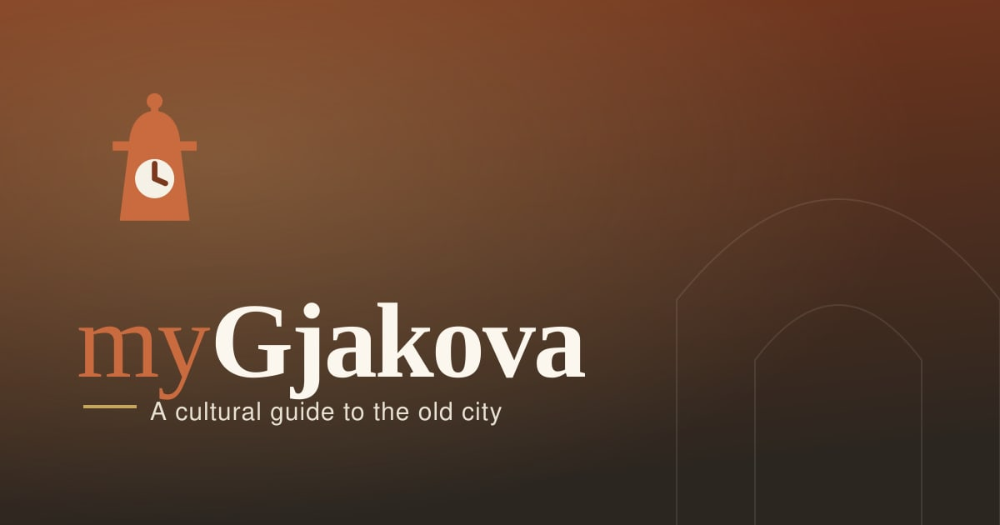
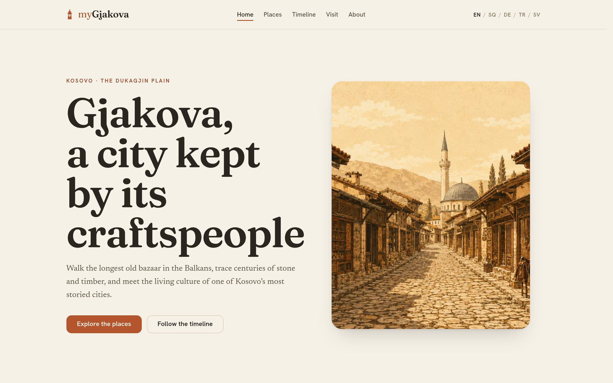
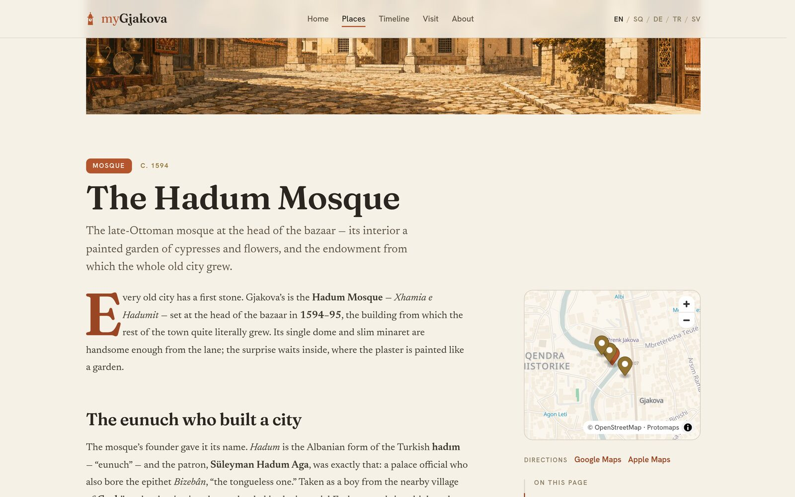
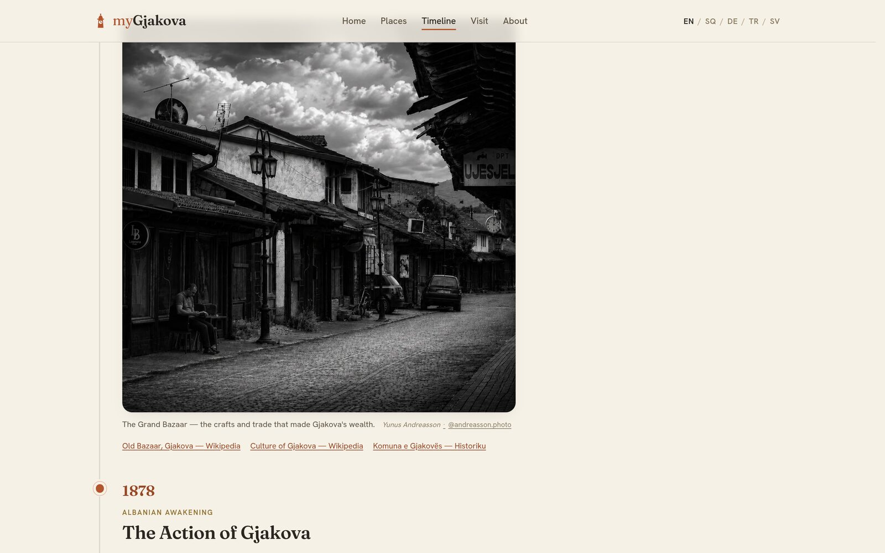
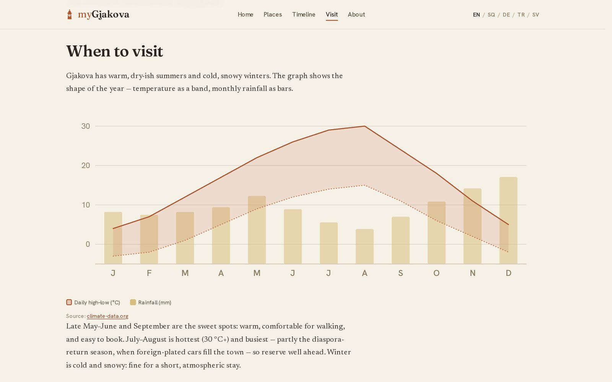
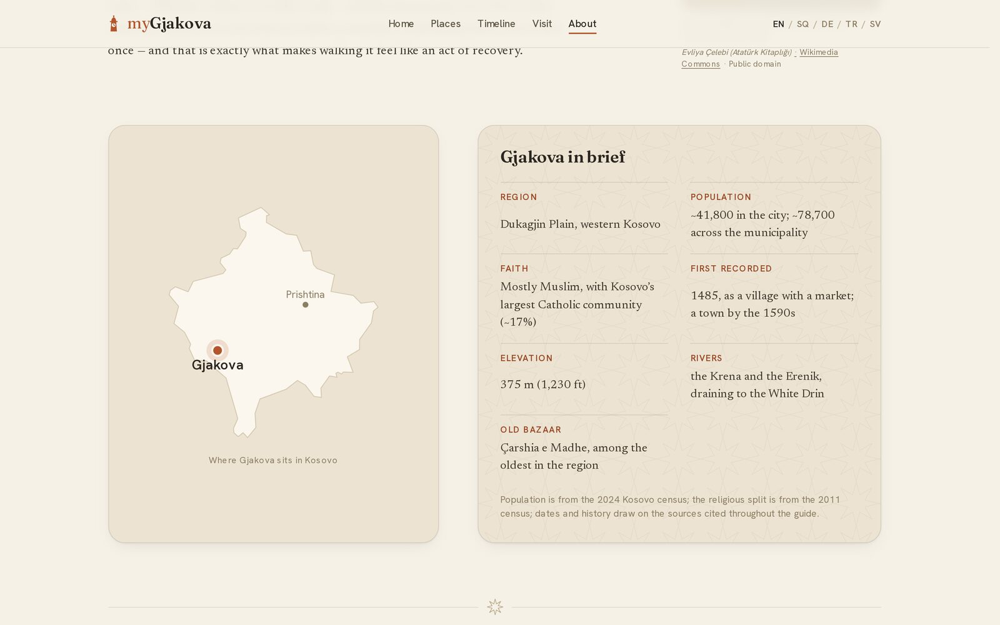
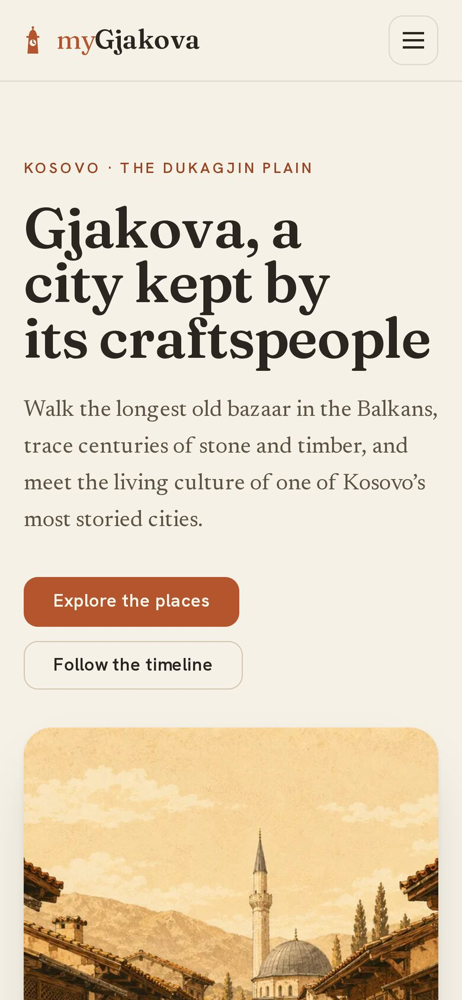
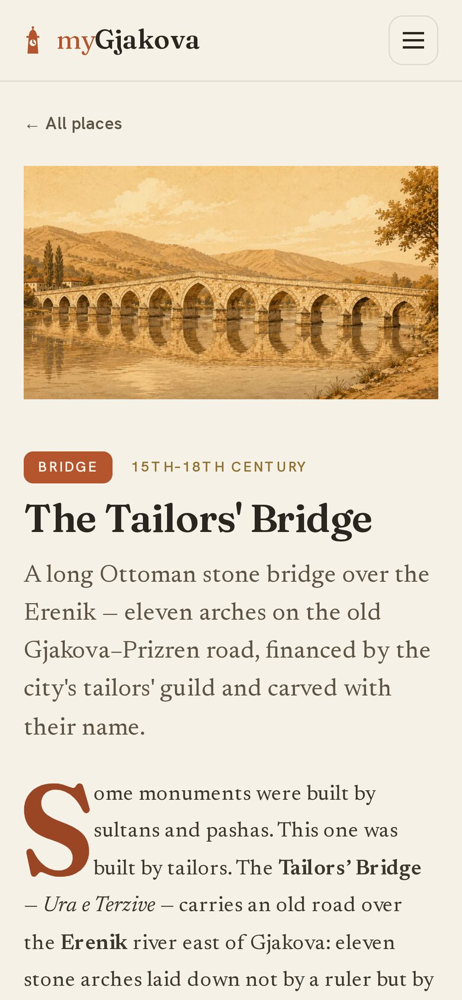
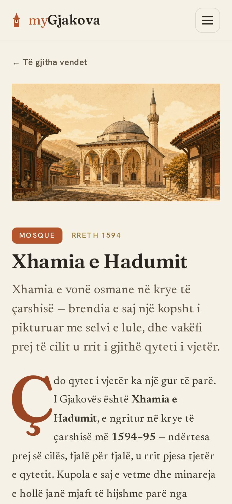

<p align="center">
  <a href="https://mygjakova.com">
    
  </a>
</p>

<p align="center">
  A static Astro site in five languages on Cloudflare Pages,<br>
  with its own map tiles and a credit for every borrowed image.
</p>

<p align="center">
  <a href="https://mygjakova.com"><b>mygjakova.com</b></a> ·
  <a href="#run-it-locally">Run it locally</a> ·
  <a href="docs/SOURCES.md">Sources</a> ·
  <a href="docs/IMAGES.md">Image credits</a> ·
  <a href="docs/">Docs</a>
</p>

<p align="center">
  <a href="https://github.com/YunusAndreasson/mygjakova/actions/workflows/verify.yml"></a>
  <a href="LICENSE"></a>
</p>

<br>



## Features

- **Places.** Nine guides, from the Grand Bazaar and the Hadum Mosque to
  Radoniq Lake and the Accursed Mountains. Each cites its sources, drawn from
  a [bibliography](docs/SOURCES.md) that also lists the traps, such as
  the TDV İslâm Ansiklopedisi entry for "Yakova", which is about Đakovo in
  Croatia.
- **Timeline.** Thirteen events, from the first mention of Gjakova in 1485 to
  the rebuilt Hadum library in 2016, twelve of them illustrated with archival
  material or photographs.
- **Visit.** Getting there, when to come, where to stay, and halal food and
  prayer. The climate chart is inline SVG drawn from monthly normals, with no
  chart library.
- **Five languages.** English, Albanian, German, Turkish and Swedish, each a
  full mirror. A page without a translation returns 404 instead of falling back
  to English. Arabic is planned, and the CSS uses logical properties so the
  layout can flip right to left.
- **Credits.** Every image from Wikimedia Commons shows its author, source and
  licence on the page. Each credit is recorded once, with its licence checked
  against Commons, in a manifest that writes both the pages' front matter and
  the [ledger](docs/IMAGES.md).
- **Self-hosted map.** MapLibre over a 2.6 MB Protomaps extract of Gjakova,
  served from the site itself, so there's no API key or third-party request
  and the Content Security Policy stays same-origin. Without JavaScript it's a
  link to OpenStreetMap.

<table>
  <tr>
    <td width="50%"></td>
    <td width="50%"></td>
  </tr>
  <tr>
    <td align="center"><sub><b>Places</b>, the Hadum Mosque</sub></td>
    <td align="center"><sub><b>Timeline</b>, a figure with its credit and sources</sub></td>
  </tr>
  <tr>
    <td width="50%"></td>
    <td width="50%"></td>
  </tr>
  <tr>
    <td align="center"><sub><b>Visit</b>, the climate chart</sub></td>
    <td align="center"><sub><b>About</b>, Gjakova in brief</sub></td>
  </tr>
</table>

<table>
  <tr>
    <td width="33%"></td>
    <td width="33%"></td>
    <td width="33%"></td>
  </tr>
  <tr>
    <td align="center"><sub>Home</sub></td>
    <td align="center"><sub>The Tailors' Bridge</sub></td>
    <td align="center"><sub>The same guide in Albanian</sub></td>
  </tr>
</table>

## Run it locally

You need Node 26 and pnpm 11, the versions CI uses.

```sh
pnpm install --frozen-lockfile
pnpm dev        # http://localhost:4321
pnpm verify     # Biome, astro check, Vitest and the full build
```

The build optimises about 200 images with sharp, so it takes a few minutes. If
sharp fails to install on a machine with libvips installed system-wide, set
`SHARP_IGNORE_GLOBAL_LIBVIPS=1` and install again.

## Docs

- [Sources](docs/SOURCES.md): the bibliography, and the cautions to read before
  writing a date
- [Image credits](docs/IMAGES.md): every borrowed image and how to add one
- [Map](docs/MAP.md): the place maps and the Kosovo locator, and how to
  regenerate them
- [SEO](docs/SEO.md): titles, structured data, headers and share cards
- [Contributing](CONTRIBUTING.md)

## Under the hood

- [Astro](https://astro.build) 6, static output, with its Fonts API and
  built-in CSP
- [Tailwind CSS](https://tailwindcss.com) 4
- [MapLibre GL JS](https://maplibre.org) and
  [PMTiles](https://github.com/protomaps/PMTiles) over a
  [Protomaps](https://protomaps.com) basemap of
  [OpenStreetMap](https://www.openstreetmap.org/copyright) data
- [sharp](https://sharp.pixelplumbing.com) for images and share cards
- [Biome](https://biomejs.dev) and [Vitest](https://vitest.dev)
- [Cloudflare Pages](https://pages.cloudflare.com) for hosting

## License

The code is [MIT](LICENSE). The written guide, the photographs, the
illustrations and the myGjakova name and mark are not; images from Wikimedia
Commons keep their own licences. [LICENSE](LICENSE) lists which files are
which.
